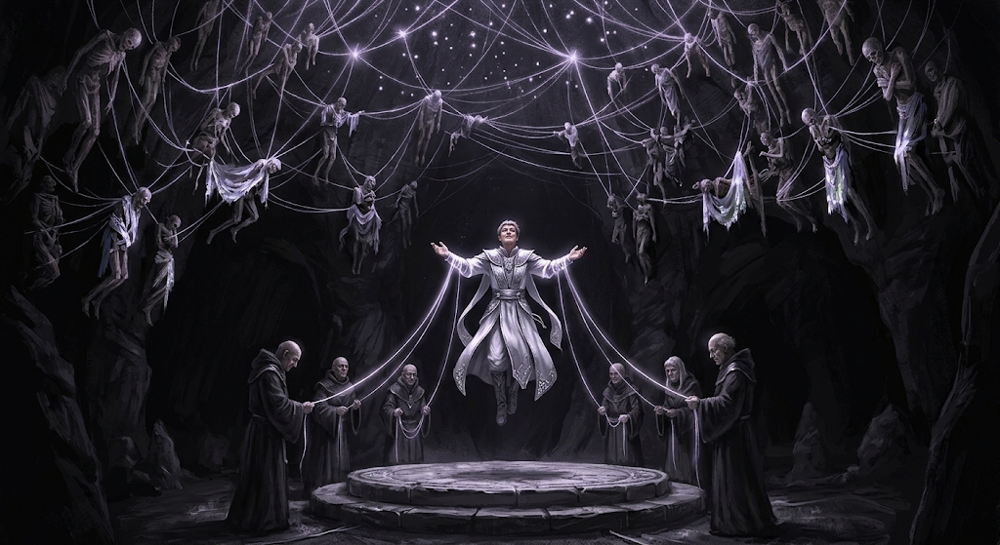

Lars had joined the monks five months ago. He had spent a long time studying the
scriptures and learning to meditate. Today he would face his final evaluation before
being accepted into the order for good. Since leaving the war, he had never felt so
at peace; even if, in the end, he was not accepted, his stay had already healed him.

In the small garden plot he tended, he had planted some potatoes that were growing
well. He took up the hoe and dug furrows to improve the irrigation. Though it was
tiring work, he liked to watch the threads — thin as spider silk — that seemed to
shine with their own light, spreading through the air whenever he turned the soil.
It was an almost divine sight, the result of the concentration of soul magic in the
region. He wanted to learn magic not to gain power, but simply to weave those webs
with his own hands.

As he drove the hoe into the ground, a group of three monks approached. Their white
robes, trimmed in silver, reflected the sunlight in every direction, at times
dazzling everything around them.

— Abandoner Lars — announced one of the monks; that was the title given to disciples
not yet approved — the time for your transition has come. Today you abandon worldly
life and enter our society as a Free one. Come with us.

Lars dropped the hoe and followed the group. He was escorted through several levels
of the temple, past kitchens, quarries and weaving rooms. Everyone there wore beige
robes, like his, and worked in pursuit of the same peace.

After a short but steep climb, they reached the doors of a grand temple, carved into
the hollowed-out mountainside. They entered through an open archway, watched over by
monks who guided birds of prey to keep an aerial view of the grounds. It was
possible — if one paid attention — to see thin threads of soul linking the monks to
the birds: not mere puppet strings, but deep bonds between the souls of the animals
and those of their keepers.

In the main chamber, Lars stood at the center, alongside other initiates who would
also undergo the transition. Before them, the council of monks waited. The five
councillors took their seats; the patriarch rose and addressed the abandoners:

— Dear ones, today you abandon your earthly lives for good. You came in search of
peace, of connection with your own souls, and of strength — to face or to escape
worldly pain. We are pleased with your progress: you are ready.

Lars held back his joy; he had been accepted. The transition ritual would soon begin.

Some monks came out through doors beneath the dais. They stopped before each
abandoner, offering the white and silver robes that all of them coveted. They took
off their beige clothes and put on the new ones.

— You now receive the silver robes, a reflection of the enlightenment you have
attained. Only one final task remains.

In single file, they descended through a system of caves, lit only by fireflies led
by one of the councillors. After a few minutes of descent, a pale light appeared in
an opening at the end of the corridor.

Passing through, they came upon a great chamber whose ceiling was woven with pale,
glowing threads — a sign of soul magic at work. Though they were underground, Lars
had the feeling of gazing at a starry sky.

At the center stood a ceremonial platform. The first abandoner stepped into the
circle; the councillors drew out threads of soul and bound themselves to the
initiate's limbs. He was lifted from the ground up to the cave's ceiling, laughing
with a pure, contagious joy that lifted the spirits of the rest. One by one, the
followers were carried up into the starry darkness above — until it was Lars's turn.

The threads wound around his arms. As he was lifted, his vision was flooded by an
intense white that blinded him. Closing his eyes did no good; only later did the
light fade. Before him stood familiar faces: Monroe, Isla and Kopi. But weren't they
dead? Had he died?

— No, you haven't died, Lars — said Monroe, in the gentle voice Lars remembered — but
you took so long! We've been waiting for you since we died in the war. What kept you?

Speechless, Lars ran to embrace his old comrade, overcome with longing.

— Don't be melancholy, Lars. We're not — said Kopi while Lars was still embracing
Monroe.

The words sounded strange. Looking over his shoulder, he saw Kopi, his features
distorted. He pulled away. All his comrades had become terrifying: body parts were
missing, blood ran everywhere, there were claws and sharp teeth.

— You killed us. Now we want revenge!

Lars tried to run and scream, but it was useless. He was swiftly consumed by his
fallen comrades.

Outside, the council watched the bodies of the new initiates wither away.

— Another failure. Five months of work for just six more months of life from each of
them. A pity — declared one of the councillors, as his wrinkles seemed to soften. —
Send word to all the recruiters. We need people with stronger souls, or we won't be
able to sustain ourselves.

Lars's body, now mummified, was left in the dungeon, tormented for eternity alongside
the constellation of other bodies hanging beside it.
