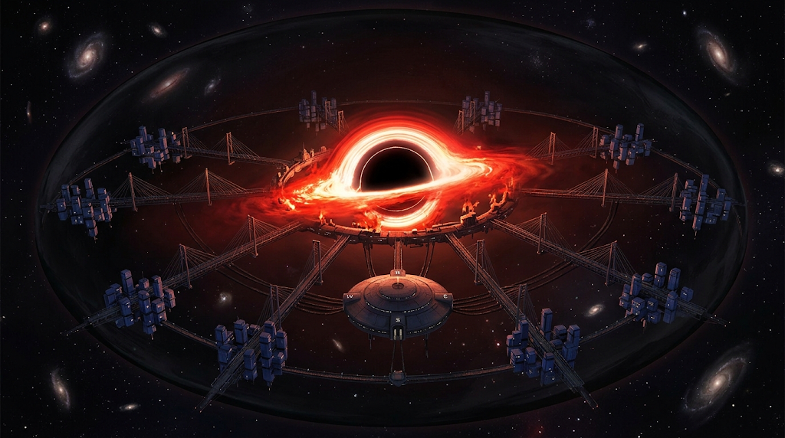
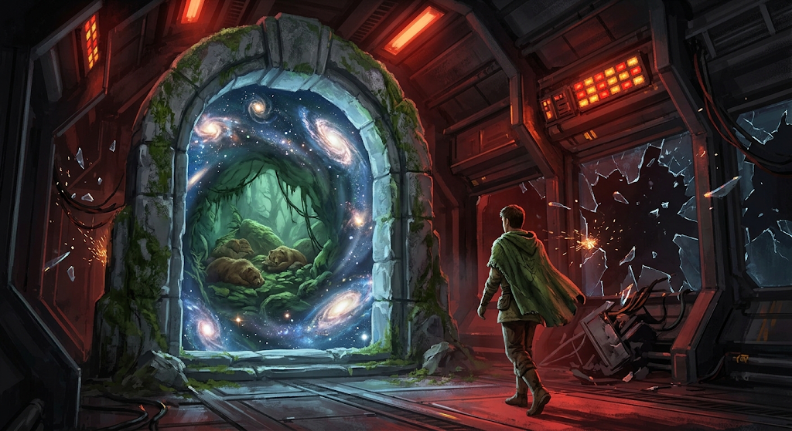

O despertador de Voss tocou com sons suaves de pássaros. Projeções de sóis brilhantes
iluminavam o teto de seu quarto de solteiro apertado. — Ainda bem que inventaram esses
'berenguenjonsons' — pensou ele. — Adoro esta cidade, mas é realmente difícil
distinguir dia de noite. Ele saiu dos edredons espumados e plásticos e colocou os pés
no teto. Abriu o chuveiro e tomou um banho quente; a água na nuca e o som da resistência
o despertaram por completo.

Andando pela parede de sua pequenina torre de dois compartimentos, ele chegou à cozinha,
comeu duas torradas e partiu para o dia de trabalho. A luz do anel de fótons do buraco
negro penetrava pela porta entreaberta, invadindo a casa e tingindo as paredes azul-índigo
de um vermelho intenso, quase amarelado; quase o cegava. Era uma paisagem monótona,
sempre vermelha. Isso cansava Voss. Mas aquele seria um dia especial.

No caminho de pontes metálicas estaiadas, que se estendiam em todas as direções, Voss
assobiava feliz. Submetera sua candidatura ao escritório de investigação e
desenvolvimento para, enfim, trabalhar em campo. Abandonaria aquela paisagem artificial
e rubra para conhecer os verdes e azuis vistos apenas em livros e relatórios. Nunca mais
veria papelada, nem escritórios fechados; nunca mais acordaria no vermelho.

A grande vantagem de sua casa ficar exatamente oposta ao escritório era que ele podia
simplesmente pular para chegar. Olhando para cima, o prédio redondo, suspenso por cabos
de aço e com quatro acessos, como pontos de uma bússola, situava-se exatamente entre ele
e o buraco negro no centro da cidade. Era a única vista que realmente apreciava. O disco
de acreção adornava o escritório como se fosse o mais imponente, e não o gigante supermassivo que
gerava energia para sustentar todos os que viviam naquele frágil e negro ovo.
Voss olhou para um lado — ninguém; no outro, apenas um oficial à distância. Preparou-se
e então saltou com todas as suas forças. Saiu do campo gravitacional artificial que o
mantinha preso ao chão e começou a flutuar em direção ao buraco negro. A sensação de
liberdade que teve naqueles breves segundos foi interrompida apenas pelos gritos
desesperados do oficial:

— Um dia você ainda cairá e morrerá, Voss! — gritou o oficial.

Ligando rapidamente as botas antigravidade, ele desacelerou suavemente e pousou sem
grandes problemas na porta do **Departamento de Análise e Retomada Planetária**. Animado,
correu diretamente para a sala da **Diretoria de História e Previsão Estratégica**. Na
sala, ele e outros candidatos aguardavam pacientemente os diretores para a divulgação
do resultado das candidaturas. Quem teria sido aprovado? Quem teria, enfim, a
oportunidade de visitar *Navajo*?

Então os diretores apareceram, suas cadeiras flutuando no salão alto. Eram figuras
imponentes, completamente fardadas em uniformes carmesins, sinal de alto escalão. Voss
ainda preferia seu curto manto verde. **Dorok** ergueu o braço e a sala caiu em silêncio.
Ele então anunciou:

— Caros analistas, sei que aguardam com ansiedade a oportunidade de visitar nossa
prometida *Navajo* novamente. Há gerações estudamos o trajeto do planeta e das sociedades
que ainda o habitam, buscando uma chance de retorno. O trabalho de vocês, até agora e o
que ainda está por vir, é, de fato, o mais importante que existe em *Penrose*.

A fala foi interrompida por **Liliane**:

— No entanto, temo que temos más notícias para todos. Um de nossos agentes retornou
há poucos minutos com a informação de que uma grande guerra ocorre neste momento no
planeta. Por essa razão, somos obrigados a retirar todos os agentes de níveis 1 e 2 do
planeta. Isso inclui vocês nesta sala hoje, como novos agentes.

Finalmente, **Jéssica** falou:

— Lembramos os valores de nossa sociedade: Colaboração, Paz e Não-Intromissão. Em prol
de garantir esses valores, tomamos a decisão: nenhum agente novo será aprovado hoje. Vocês
permanecerão conosco aqui em *Penrose*, colaborando para que, em outra oportunidade,
possamos retornar seguramente a *Navajo*.

Em uníssono:

— Para que um dia voltemos! — todos gritavam.

Os diretores silenciaram e começaram a se retirar da sala. As outras pessoas mantiveram
um silêncio fúnebre. Só Voss permaneceu no centro; não disse nada, mas sua raiva falava
mais alto que mil vozes, e o deixou tão vermelho quanto a cidade. Como poderiam fazer
aquilo com ele? Como poderiam abandonar o planeta mais uma vez? Como podiam ser tão
inertes? Como podiam **impedi-lo de realizar seu sonho**? Não passavam de covardes, que
esperariam ver o planeta se destruir em vez de retomar a terra prometida. E ele jurou que
voltaria, mesmo que tivesse de alcançar o raio de Schwarzschild para tanto. Afinal, os
portais do terminal para *Navajo* estavam logo atrás daquela porta.

A sala começou a ranger. Todos pararam para ouvir a estrutura de ferro ranger. Alguns
parafusos saltaram de seus lugares e as pessoas se protegeram. Uma figura surgiu acima da
multidão, flutuando apesar de não usar as elegantes plataformas de controle gravitacional
dos diretores. Seus olhos tinham um brilho carmesim intenso. Os diretores sacaram seus
mecanismos de ancoragem gravitacional, mas já era tarde demais. Com um gesto das mãos,
**Voss** fez o salão implodir: arcos amassaram-se, vidros estilhaçaram-se, e pessoas foram
projetadas a flutuar no espaço, caindo pelo horizonte de eventos. As portas do terminal
abriram-se. Ele avançou até a velha estrutura de pedra coberta de musgo; era bela, e os
resquícios do portal ainda traziam umidade ao ambiente. Que sensação fantástica! Ao alcançar
o vazio guardado pela moldura cinzenta, viu o espaço dobrar-se: sinais de grandes galáxias
e sistemas solares, poeira estelar e, finalmente, um planeta — uma caverna úmida onde,
calmamente, dormiam criaturas que ele julgou serem ursos. Isso, ursos! Que criaturas! Então
atravessou o limiar com um sorriso. O portal fechou-se atrás dele, deixando apenas as
sirenes de emergência e os gritos apagados no vácuo do espaço.

